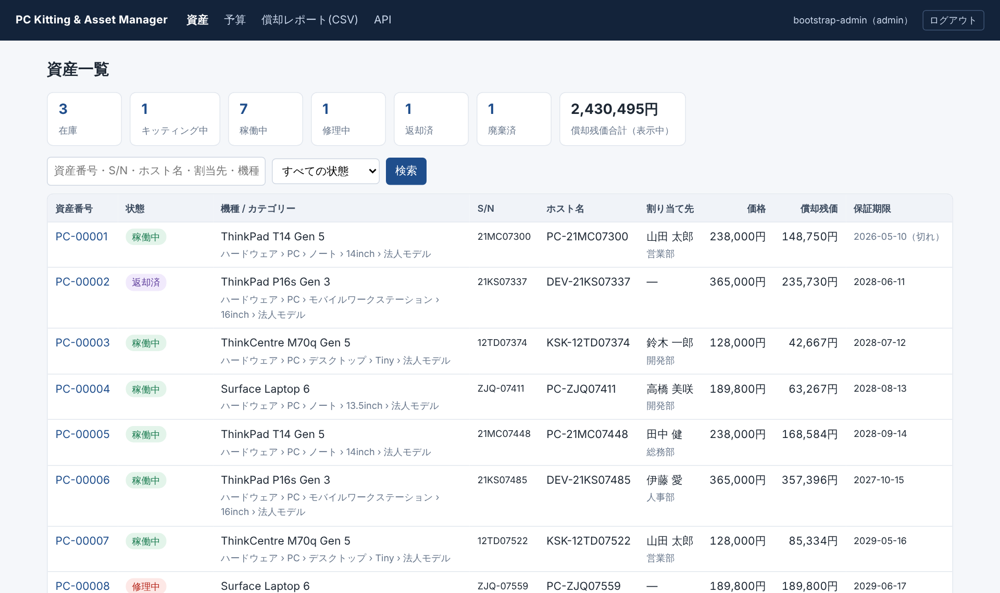
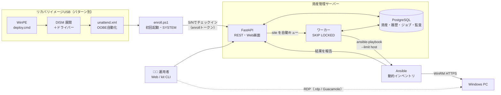
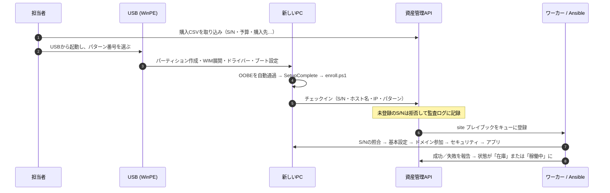
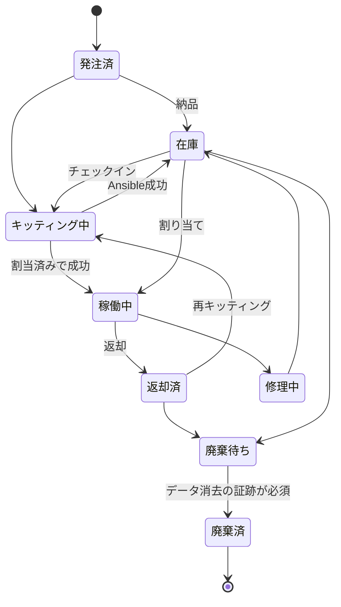
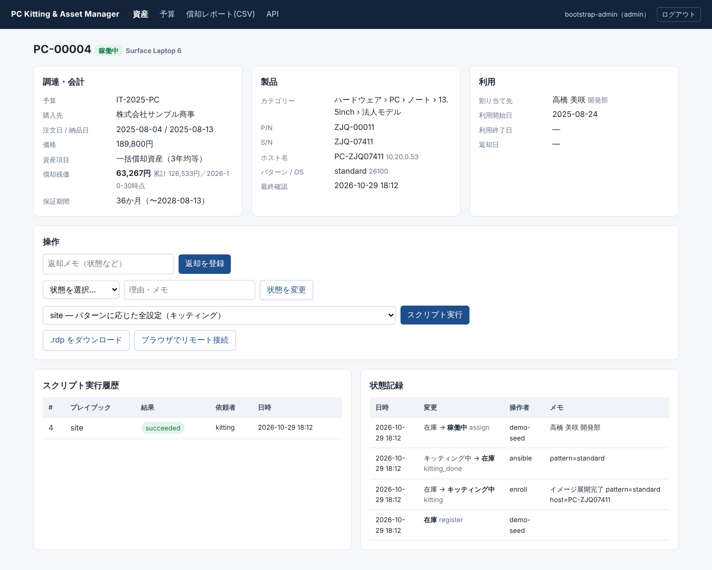
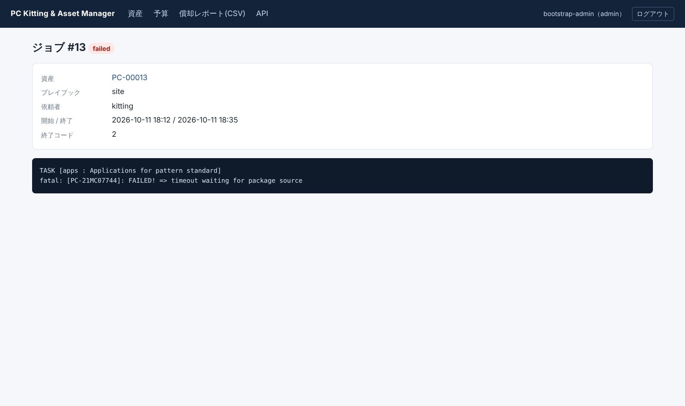

# PC Kitting & Asset Manager

**リカバリイメージUSB × Ansible による Windows PC キッティングと、調達から廃棄までの資産管理を一体化したシステム**

PCの「発注 → 納品 → イメージ展開 → 設定 → 割り当て → 返却 → 廃棄」までを1つのデータベースで管理します。イメージを展開したPCは、起動すると自分のシリアル番号で資産DBにチェックインします。チェックインを受けたDBは、そのPCの用途パターンに合わせたAnsibleの設定を自動で実行キューに入れます。人が行う作業は、USBから起動してパターン番号を選ぶことだけです。

> English: Windows PC kitting and IT asset lifecycle management in one system — per-pattern recovery-image USBs (WinPE + DISM + unattend), first-boot enrollment to the asset DB, Ansible over WinRM driven by a dynamic inventory, a FastAPI/PostgreSQL asset register with Japanese depreciation rules, an audited job runner, RDP via .rdp files or Apache Guacamole, and a `kit` CLI.



---

## 全体像



### キッティングの流れ



## 主な機能

| 領域 | 内容 |
|---|---|
| **イメージUSB** | パターン（標準・開発者・受付端末など）をYAMLで定義し、`kit-image build` で展開スクリプト・パーティション定義・無人応答ファイル・初回起動スクリプトを生成。`New-KittingUsb.ps1` でブート用FAT32＋データ用NTFSの2パーティションUSBを作成（4GBを超えるWIMにも対応） |
| **Ansible** | 資産DBを**動的インベントリ**として使用し、パターン・状態・部署ごとにグループ化。ロールは `collect_facts`（S/N照合）／`baseline`／`domain_join`／`security`（BitLocker・Defender・ファイアウォール・Windows LAPS・SMBv1無効化）／`apps`（社内ミラーからChocolatey）／`report` |
| **資産管理DB** | 予算、購入先、注文日、納品日、カテゴリー1〜5、P/N、S/N、割り当て先、価格、保証期間、資産項目、償却残価、利用開始日、利用終了日、返却日、廃棄処理、廃棄日、状態記録 |
| **Script Running** | 許可済みプレイブックだけを資産単位で実行。出力・終了コード・依頼者を保存。複数ワーカーで並列に処理しても二重実行しない |
| **リモートデスクトップ** | `.rdp` ファイルの発行（NLA必須・ドライブのリダイレクトなし・RDゲートウェイ対応）と、**Apache Guacamole** によるブラウザからの接続（セッションの録画あり）。どちらも監査ログに記録 |
| **CLIツール** | `kit ls / show / import / assign / return / status / dispose / run / jobs / rdp / remote / budgets / report / token` |
| **レポート** | 予算の執行状況、年度末時点の償却残価CSV（会計連携用） |

## 資産管理の設計

### 状態遷移



- 定義にない遷移は拒否します。たとえば「割り当て中のPCを廃棄待ちにする」「廃棄済みを在庫に戻す」はできません。
- すべての変更を**状態記録**（追記のみ）と**監査ログ**に残します。状態を変える処理を必ずサービス層の1か所に通しているので、Web・API・CLIのどこから操作しても記録が漏れません。
- **廃棄処理には、データ消去の方法と証跡の入力が必須**です（例：NIST SP 800-88 Purge、消去証明書番号）。

### 償却残価

| 資産項目 | 取得価額の目安 | 計算 |
|---|---|---|
| 消耗品 | 10万円未満 | 利用開始時に全額費用処理（残価0） |
| 一括償却資産 | 10万〜20万円未満 | 3年度で1/3ずつ（月割りなし） |
| 少額減価償却資産 | 中小企業の特例 | 利用開始時に全額費用処理 |
| 減価償却資産 | 20万円以上 | 定額法・月割り。耐用年数はPCが4年。残価は備忘価額の1円まで |

資産項目は価格から自動で判定し、個別に上書きもできます。年度の開始月は設定で変えられます。管理会計上の目安として計算しているため、実際の処理は経理部門・税理士の判断に合わせてください。

### 権限

| ロール | できること |
|---|---|
| `admin` | すべての操作（廃棄・予算・トークン発行・監査ログ閲覧を含む） |
| `operator` | 登録・割り当て・返却・状態変更・スクリプト実行・リモート接続 |
| `viewer` | 閲覧のみ |
| `enroll` | **チェックインのみ**。USBに入れるトークンなので、資産一覧やインベントリは読めない |

トークンはSHA-256のハッシュでしか保存しません。Web画面は HttpOnly かつ SameSite=Strict のCookieを使い、さらにOriginヘッダーを確認してCSRFを防ぎます。

## セキュリティ上の配慮

- **不正な端末の排除**：資産DBに登録されていないS/Nはチェックインを拒否し、監査ログに残します。
- **取り違え防止**：Ansibleは最初に、端末の実際のS/NとDBのS/Nを照合します。一致しなければ処理を止めます（作業台で隣のPCを設定してしまう事故を防ぐため）。
- **管理経路の限定**：WinRMはHTTPSのみで、管理用サブネットからしか受け付けません。BasicとHTTPは無効化します。
- **一時的な管理者パスワード**：unattend.xml内のパスワードは符号化しているだけで暗号化ではありません。キッティング後はWindows LAPSが自動でローテーションします。
- **ジョブ実行**：許可リストにあるプレイブックだけを実行できます。変数はフラットな値のみ受け付け、シェルを経由せず引数のリストとして渡します。
- **秘密情報**：BitLockerの回復キーは `no_log` にしてジョブ出力に残しません。リモートデスクトップはドライブのリダイレクトを無効にしています。

## 画面

| 資産詳細（操作・スクリプト実行履歴・状態記録） | ジョブ出力 |
|---|---|
|  |  |

### CLI

```console
$ export KIT_URL=https://assets.example.local KIT_TOKEN=****
$ kit ls --status 稼働中
資産番号  状態    機種                    S/N        ホスト名       割当先     価格     償却残価
--------  ------  ----------------------  ---------  -------------  ---------  -------  --------
PC-00001  稼働中  ThinkPad T14 Gen 5      21MC07300  PC-21MC07300   山田 太郎  238,000  148,750
PC-00003  稼働中  ThinkCentre M70q Gen 5  12TD07374  KSK-12TD07374  鈴木 一郎  128,000  42,667
PC-00004  稼働中  Surface Laptop 6        ZJQ-07411  PC-ZJQ07411    高橋 美咲  189,800  63,267

$ kit import 2026-11-purchase.csv          # 1行でも誤りがあれば全件取り消し
$ kit run PC-00004 security --wait         # Ansibleを実行し、結果を待つ
$ kit rdp PC-00004 --open                  # .rdp を保存して開く
$ kit report depreciation > fy2026.csv     # 年度末時点の償却残価
```

## 使い方

```bash
# 1. サーバー（API + ワーカー×2 + PostgreSQL + Guacamole）
cp .env.example .env              # パスワード・トークンを設定
docker compose up -d

# 2. パターンを確認し、USB用ファイルを生成
pip install -e .
kit-image validate
KIT_LOCAL_ADMIN_PASSWORD=... KIT_ENROLL_TOKEN=... kit-image build standard --out dist

# 3. USBを作成（Windows・管理者権限のPowerShell・ADK + WinPE アドオン）
.\imaging\New-KittingUsb.ps1 -DiskNumber 2 -Patterns standard,developer,kiosk -ImageRoot D:\kitting

# デモデータで画面を試す
ASSETDB_URL=sqlite:///./demo.sqlite python scripts/demo_seed.py
ASSETDB_URL=sqlite:///./demo.sqlite BOOTSTRAP_ADMIN_TOKEN=demo uvicorn assetdb.main:app
```

### パターン定義（例：`imaging/patterns/standard.yml`）

```yaml
name: standard
image:   { wim: images/win11-24h2-enterprise.wim, index: 1, drivers: drivers/thinkpad-t14-gen5 }
oobe:    { locale: ja-JP, timezone: Tokyo Standard Time, hostname_prefix: PC }
enroll:  { url: https://assets.example.local/api/v1/kitting/checkin, management_subnet: 10.10.0.0/24 }
ansible:
  join_domain: true
  ou: OU=Standard,OU=PCs,DC=corp,DC=example
  bitlocker: true
  apps: [googlechrome, 7zip, adobereader, microsoft-teams-new-bootstrapper]
```

USBの生成とAnsibleは**同じYAMLを読み込む**ので、イメージ側と設定側でパターンの内容が食い違うことはありません。

## テスト・CI

```bash
pytest -q                                    # 43件（SQLite）
ASSETDB_TEST_URL=postgresql+psycopg://... pytest -q   # 同じ43件をPostgreSQLで実行
cd ansible && ansible-lint --offline playbooks/ roles/   # production プロファイルで合格
```

| テスト | 検証内容 |
|---|---|
| 償却計算 | 区分の閾値、定額法の月割り、備忘価額、一括償却の年度処理 |
| ライフサイクル | 全項目の登録、予算超過の拒否、割り当て中の廃棄禁止、廃棄にデータ消去の証跡が必須、状態記録・監査ログ、CSVの全件ロールバック |
| キッティング | チェックインでsiteが自動キューされる（重複しない）、未登録S/Nの拒否、NetBIOS名の検証、報告による状態遷移、インベントリから退役機を除外 |
| ジョブ | 許可リスト・変数の検証、同じ資産での同時実行の禁止、出力の末尾を残す切り詰め |
| リモート | .rdpの内容、Guacamoleの接続を1回だけ作成、権限、監査 |
| CLI・Web | 実APIとの一連の操作、全角文字を含む列の整列、ログインCookie、CSRFの拒否 |
| イメージ | パターン検証（相対パス・https・名前規則）、XMLの妥当性、パスワードが平文で出ないこと、PowerShell・XMLのエスケープ |

GitHub Actionsでは、SQLite／PostgreSQLの両方でのテスト、ansible-lint、全プレイブックのsyntax-check、全パターンのビルドを実行します。

## 構成

```
src/assetdb/        資産管理（FastAPI・SQLAlchemy）
  models.py          テーブル定義（資産・予算・状態記録・ジョブ・トークン・監査）
  services.py        ライフサイクルの規則（状態遷移・割り当て・廃棄・チェックイン・CSV）
  depreciation.py    償却残価の計算
  jobs.py            スクリプト実行（キュー・ワーカー・許可リスト）
  remote.py          .rdp ファイルの生成と Guacamole 連携
  inventory.py       Ansible 動的インベントリ
  api.py / web.py    REST API / Web画面
  cli.py             kit コマンド
src/kitimage/       USB用ファイルの生成（パターン検証・テンプレート）
imaging/            パターン定義（YAML）と New-KittingUsb.ps1
ansible/            プレイブック・ロール・動的インベントリ
scripts/demo_seed.py  デモデータ（架空の会社）
```

## License

MIT
